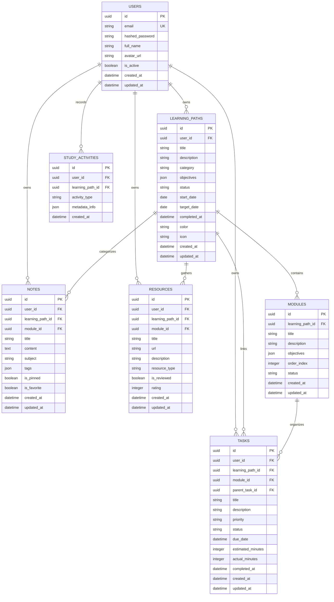

# Arquitetura do Sistema — Selftaught

## 1. Visão Geral da Arquitetura

O Selftaught foi projetado como um monorepo moderno e desacoplado, com uma API RESTful em Python FastAPI e uma Single Page Application / Server-Driven Frontend em Next.js (React + TypeScript).

```
   ┌────────────────────────────────────────────────────────┐
   │                   Frontend (Next.js)                   │
   │  App Router • Tailwind CSS • Lucide • Context API     │
   └───────────────────────────┬────────────────────────────┘
                               │ HTTP / JSON (REST)
                               ▼
   ┌────────────────────────────────────────────────────────┐
   │                   Backend (FastAPI)                    │
   │  Auth Middleware • Pydantic v2 • Service Layer         │
   └───────────────────────────┬────────────────────────────┘
                               │ SQLAlchemy 2.0 ORM
                               ▼
   ┌────────────────────────────────────────────────────────┐
   │                   Banco de Dados                       │
   │  PostgreSQL (Supabase) / SQLite (Dev & Testes)         │
   └────────────────────────────────────────────────────────┘
```

---

## 2. Modelo de Dados Relacional



---

## 3. Segurança e Autenticação

1. **Hash de Senha**: Utilização do algoritmo bcrypt via Passlib/Cryptography com salt dinâmico.
2. **Tokens JWT**: JSON Web Tokens assinados com HMAC-SHA256 e tempo de expiração configurável via variáveis de ambiente.
3. **Isolamento Multi-tenant Lógico**: Todas as rotas autenticadas filtram explicitamente por `user_id == current_user.id`. Tentativas de acessar ou alterar registros de outros usuários retornam erro 404 (para prevenir enumeração) ou 403.
4. **CORS**: Configuração de origens permitidas controlada via `BACKEND_CORS_ORIGINS`.

---

## 4. Estratégia de Banco de Dados

- **Suporte Duplo (SQLite & PostgreSQL)**: O projeto usa SQLAlchemy 2.0 assíncrono/síncrono com tipos padrão ANSI SQL e UUIDs representados de forma compatível tanto com o tipo nativo UUID do Postgres quanto com VARCHAR(36) no SQLite.
- **Alembic**: Gerenciamento de versões de esquema com suporte a autogenerate.
